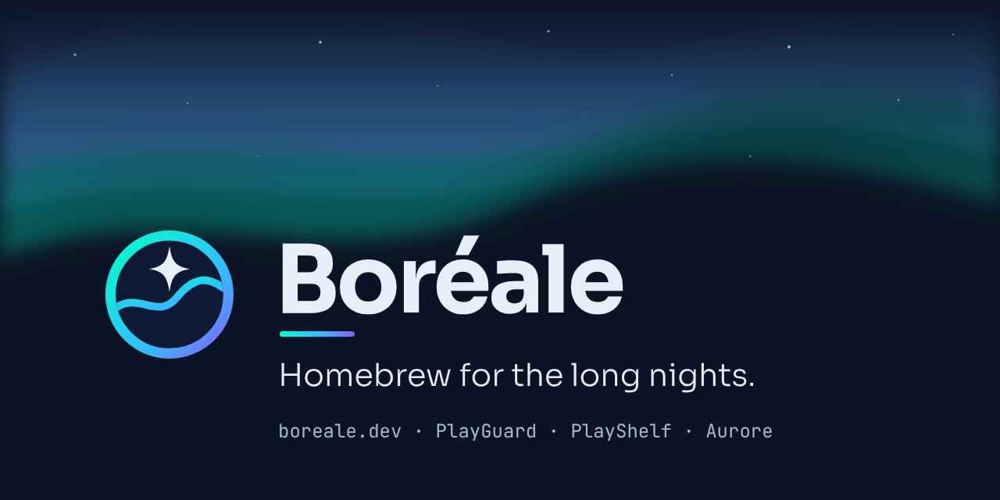

<div align="center">



### Homebrew for the long nights

**[boreale.dev](https://boreale.dev/?utm_source=github&utm_medium=readme)** · **[PlayGuard](https://github.com/JigSawFr/PlayGuard)** · **[PlayShelf](https://github.com/JigSawFr/PlayShelf)** · **[Aurore](https://github.com/JigSawFr/Aurore)**

</div>

---

Boréale is the home of a few open-source projects for the Nintendo Switch: **PlayGuard** (parental controls on the console), **PlayShelf** (your game library on the console) and **Aurore** (the borealis fork both are built with). The name closes a line that was already in the code: borealis, then Aurore, then Boréale.

This repository holds:

- **[`branding/`](branding/README.md)**: the marks, the wordmarks, the colours, the type and the tone shared by every project, as SVG and PNG.
- **[`site/`](site/README.md)**: the website at [boreale.dev](https://boreale.dev/?utm_source=github&utm_medium=readme), in the consoles' fifteen languages. The projects' sites are its sub-domains: [guard.boreale.dev](https://guard.boreale.dev/?utm_source=github&utm_medium=readme) (PlayGuard), [shelf.boreale.dev](https://shelf.boreale.dev/?utm_source=github&utm_medium=readme) (PlayShelf) and [aurore.boreale.dev](https://aurore.boreale.dev/?utm_source=github&utm_medium=readme) (Aurore).

## Build the site

```sh
python3 tools/build_site.py build     # the pages, in build/
python3 tools/check_site.py build     # links, catalogs, Content-Security-Policy
python3 tools/site_layout.py build    # phones to desktop, and axe (Playwright for Python)
python3 -m http.server -d build 8000  # then http://localhost:8000/
```

Python 3 and nothing else. `node tools/export-branding.mjs` renders the PNGs again from the SVGs (Playwright).

## License

The code and the pages: **GPLv3**, as PlayGuard, PlayShelf and Aurore (see [`LICENSE`](LICENSE)). The fonts in `site/assets/fonts/` are under the **SIL Open Font License** (their `OFL-*.txt`), except the language menu's flags (`twemoji-flags.woff2`, cut out of Twemoji's): **CC-BY 4.0** (`LICENSE-twemoji-flags.txt`). The marks and the names Boréale, PlayGuard, PlayShelf and Aurore identify these projects: use them to point to the projects, not for your own.

<sub>Not affiliated with or endorsed by Nintendo. Nintendo Switch is a trademark of Nintendo.</sub>
